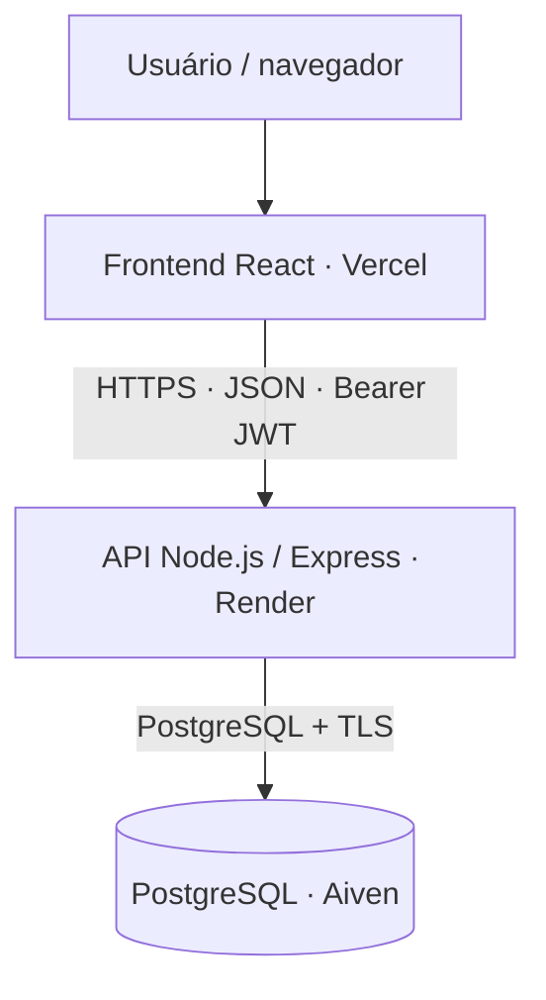

<div align="center">

# 💸 FinanceFlow

### Suas finanças organizadas. Do lançamento ao saldo.

**Aplicação full stack de controle financeiro pessoal** construída com React, TypeScript, Node.js, Express e PostgreSQL.

[](https://financeflow-six-orcin.vercel.app/)
[](https://github.com/ricardohcoco/financeflow)


**[🚀 Acessar aplicação](https://financeflow-six-orcin.vercel.app/)** · **[📦 Ver repositório](https://github.com/ricardohcoco/financeflow)**

**Status: concluído • aplicação publicada e funcional**

</div>

---

## ✨ Sobre o projeto

O **FinanceFlow** é uma aplicação web para registrar receitas e despesas, organizar movimentações por categoria e acompanhar o resultado financeiro do mês em um dashboard.

Foi desenvolvido como projeto de portfólio para consolidar o ciclo completo de uma aplicação: **interface → API REST → banco relacional**, passando por autenticação, autorização, validação, tratamento de erros, testes e deploy.

> **Experimente online:** [financeflow-six-orcin.vercel.app](https://financeflow-six-orcin.vercel.app/)  
> Crie uma conta de teste para explorar a aplicação. Evite inserir dados financeiros pessoais reais em um projeto de demonstração.

## ✅ Funcionalidades

| Área | O que está disponível |
| --- | --- |
| **Autenticação** | Cadastro, login, JWT, recuperação de sessão e logout |
| **Movimentações** | Criar, consultar, editar e excluir receitas e despesas |
| **Categorias** | Classificação por tipo, com validação de compatibilidade |
| **Filtros** | Filtragem de movimentações por tipo e categoria |
| **Dashboard** | Totais de receitas, despesas, saldo e últimas movimentações |
| **Segurança de acesso** | Rotas protegidas e isolamento dos registros por usuário |
| **Resiliência** | Estados de carregamento, mensagens de erro e tentativa de recuperação |
| **Interface** | Layout responsivo com componentes reutilizáveis e CSS Modules |

**Regra financeira:** o resumo mensal considera movimentações **do mês atual com data até hoje**. Lançamentos futuros permanecem na listagem, mas só entram nos indicadores a partir da data registrada. Os valores são somados em centavos para evitar erros comuns de ponto flutuante.

## 🧱 Tecnologias

| Camada | Stack |
| --- | --- |
| **Frontend** | React 19, TypeScript, Vite, React Router, CSS Modules, Fetch API |
| **Backend** | Node.js, Express, TypeScript, JWT, bcrypt, Zod, express-rate-limit |
| **Banco de dados** | PostgreSQL, SQL, integridade referencial |
| **Testes** | Vitest, React Testing Library, Node.js Test Runner, Insomnia |
| **Desenvolvimento** | Git, GitHub, Docker Compose |
| **Deploy** | Vercel (frontend), Render (API), Aiven (PostgreSQL) |

## ☁️ Arquitetura em produção



O **frontend** cuida da interface e envia requisições HTTP. O **backend** valida os dados, verifica a identidade e a autorização do usuário e executa as operações SQL. O **PostgreSQL** armazena os registros e mantém as relações entre usuários, categorias e movimentações.

A aplicação utiliza ambientes separados para desenvolvimento local e produção; as credenciais de produção não são incluídas no repositório.

## 🗂️ Estrutura do projeto

```text
financeflow/
├── backend/              # API REST, autenticação, SQL e testes
├── frontend/             # Interface React, componentes e testes
├── compose.yaml          # PostgreSQL para desenvolvimento local
├── .env.example          # Variáveis do banco local (modelo)
├── .gitignore
└── README.md
```

## 🚀 Executando localmente

### Pré-requisitos

- Node.js e npm compatíveis com as dependências do projeto;
- Docker e Docker Compose;
- Git.

### 1. Clone o repositório

```bash
git clone https://github.com/ricardohcoco/financeflow.git
cd financeflow
```

### 2. Configure o ambiente

Crie os arquivos de ambiente a partir dos exemplos existentes:

```powershell
Copy-Item .env.example .env
Copy-Item backend/.env.example backend/.env
Copy-Item frontend/.env.example frontend/.env
```

> Os comandos acima usam **PowerShell**. Em Linux/macOS, utilize `cp` no lugar de `Copy-Item`.

Ajuste o `.env` da raiz para o PostgreSQL do Docker e mantenha as credenciais do banco consistentes com `backend/.env`. Configure um `JWT_SECRET` forte e distinto do ambiente de produção. No frontend, use `VITE_API_URL=http://localhost:3000`.

O arquivo `backend/.env.example` documenta as variáveis de servidor e conexão; `frontend/.env.example` documenta a URL pública da API. **Nunca faça commit dos arquivos `.env` reais.**

### 3. Inicie o banco local

```bash
docker compose up -d
```

**Preparação da estrutura:** o `compose.yaml` sobe o PostgreSQL, mas **não executa automaticamente as tabelas e os dados iniciais**. Antes de usar a API em um banco novo, aplique o esquema SQL do projeto e cadastre as 11 categorias iniciais (4 receitas e 7 despesas), com IDs e tipos compatíveis com a aplicação. Esse procedimento deve ser realizado com os scripts de schema/seed do ambiente de desenvolvimento.

### 4. Execute o backend

```bash
cd backend
npm ci
npm run dev
```

API local: `http://localhost:3000`  
Health check: `http://localhost:3000/health`

### 5. Execute o frontend

Em **outro terminal**, a partir da raiz do repositório:

```bash
cd frontend
npm ci
npm run dev
```

Aplicação local: `http://localhost:5173`

## 🔌 Principais endpoints

| Método | Rota | Descrição |
| --- | --- | --- |
| `POST` | `/users` | Criar conta |
| `POST` | `/login` | Autenticar e receber JWT |
| `GET` | `/users/me` | Consultar usuário autenticado |
| `GET` | `/categories` | Listar categorias |
| `GET` | `/transactions` | Listar movimentações |
| `GET` | `/transactions/:id` | Consultar movimentação |
| `POST` | `/transactions` | Cadastrar movimentação |
| `PUT` | `/transactions/:id` | Atualizar movimentação |
| `DELETE` | `/transactions/:id` | Excluir movimentação |
| `GET` | `/health` | Verificar a API |
| `GET` | `/health/db` | Verificar a conexão com o banco |

As rotas privadas exigem o cabeçalho `Authorization: Bearer <token>`. O servidor utiliza a identidade do JWT para limitar o acesso aos dados do próprio usuário.

## 🧪 Testes e qualidade

O projeto foi concluído com **61 testes automatizados aprovados** durante o desenvolvimento:

| Camada | Quantidade | Principais cenários |
| --- | ---: | --- |
| Backend | **25** | Autenticação, autorização, CRUD, validações e falhas de infraestrutura |
| Frontend | **36** | Cálculos, HTTP, sessão, rotas protegidas, formulários e listagens |
| **Total** | **61** | |

**Backend**

```bash
cd backend
npm run test
npm run build
```

**Frontend**

```bash
cd frontend
npm run test
npm run build
npm run lint
```

Também foram realizados testes manuais no **Insomnia**, incluindo isolamento entre usuários, falha de conexão com o PostgreSQL, respostas HTTP e regressões de cadastro, edição e exclusão.

## 🔒 Segurança e decisões técnicas

- Senhas protegidas por **hash com bcrypt**.
- **JWT** utilizado na autenticação de rotas privadas.
- Autorização aplicada na **API**, não apenas no roteamento React.
- Validação de entradas com **Zod** e tratamento centralizado de erros.
- **Rate limiting** em fluxos sensíveis de autenticação.
- Conexão **TLS** entre Render e PostgreSQL Aiven, com validação do certificado CA.
- Usuário do banco destinado à aplicação com **permissões restritas**.
- Separação entre configurações e credenciais locais e de produção.

### Limitações conhecidas

O JWT é armazenado atualmente em `sessionStorage`; essa escolha facilita o projeto, mas pode expor o token caso exista uma vulnerabilidade de XSS. O logout elimina a sessão local, porém não revoga antecipadamente o JWT já emitido. Para uso com dados financeiros reais, seria necessário revisar a estratégia de sessão e conduzir uma avaliação adicional de segurança.

## 📌 Status do projeto

**✅ Concluído e publicado em produção.**

- **Aplicação:** https://financeflow-six-orcin.vercel.app/
- **Código-fonte:** https://github.com/ricardohcoco/financeflow
- **Infraestrutura:** Vercel + Render + Aiven PostgreSQL
- **Testes:** 25 backend + 36 frontend

> O projeto está disponível para demonstração e avaliação técnica. Serviços hospedados em planos gratuitos podem apresentar um atraso na primeira requisição após períodos de inatividade.

---

<div align="center">

Desenvolvido por **[Ricardo Coco](https://github.com/ricardohcoco)** como projeto de estudos e portfólio em desenvolvimento full stack.

**[Acessar FinanceFlow](https://financeflow-six-orcin.vercel.app/)** · **[Voltar ao topo](#-financeflow)**

</div>
